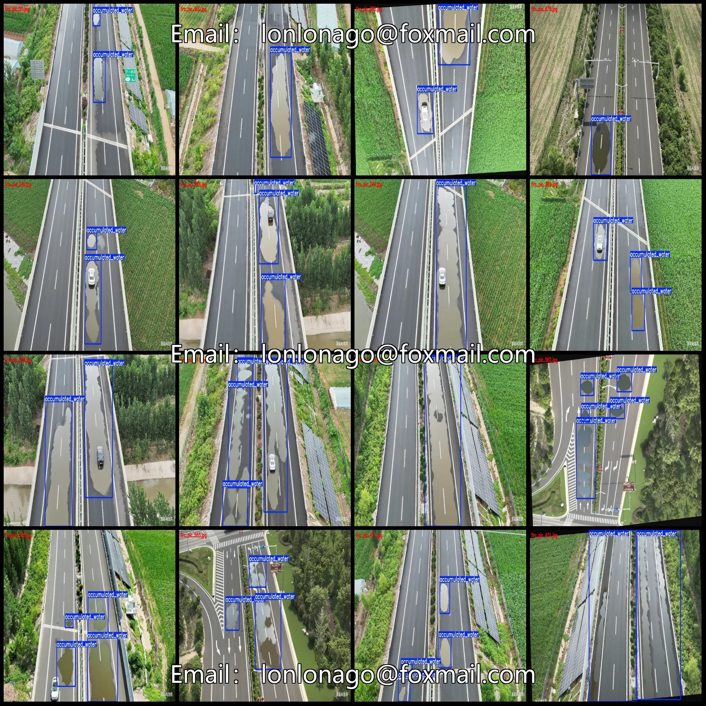
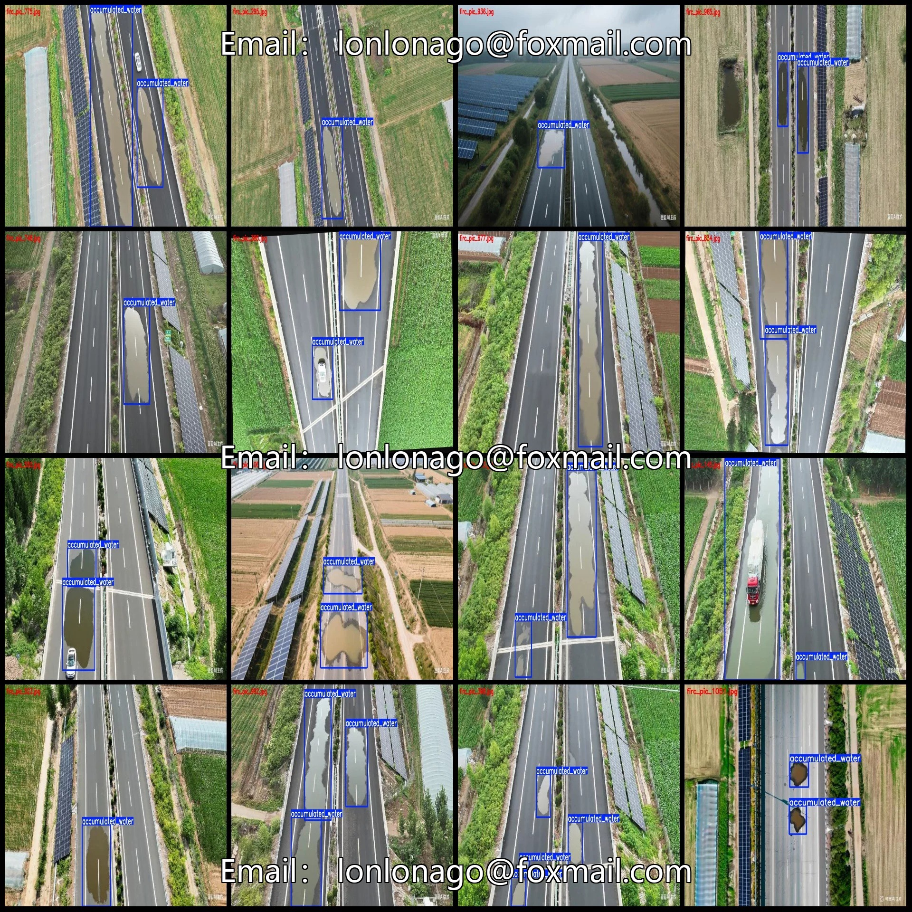
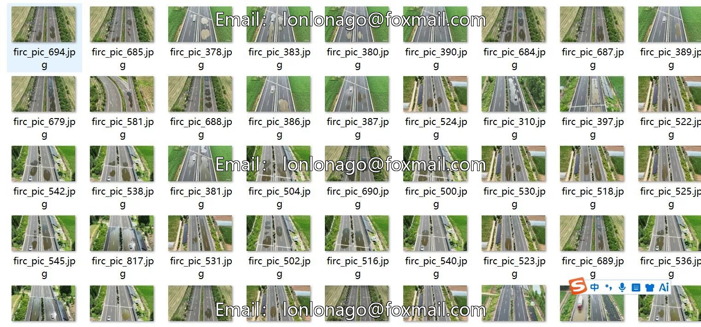
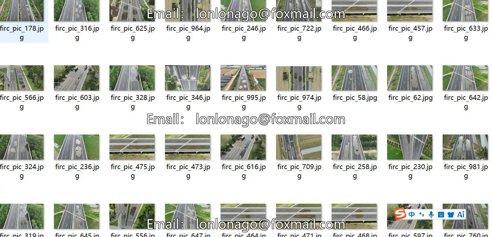

# Highway surface water detection dataset in VOC+YOLO format from drone perspectives

## Body

Drone-view aerial photography dataset for highway surface water detection in VOC+YOLO format with 1074 images and 1 category
Warm reminder: Due to the dataset's replicability, please confirm compliance before purchasing.
Dataset format: Pascal VOC format + YOLO format (txt file without split path, only contains jpg images and corresponding VOC format xml files and yolo format txt files)
Number of images (number of jpg files): 1074
Number of annotations (number of xml files): 1074
Number of annotations (number of txt files): 1074
Label category count: 1
Label category name: ["accumulated_water"]
Number of boxes labeled in each category

Accumulated_water Frames = 2822
Total Frames: 2822
Number of Images per Category
Accumulated_water Frames per Image = 1074
Image resolution: Multi-resolution images, such as 1312x703, 1312x735, etc.
Labeling tool used: labelImg
Labeling rules: Draw a rectangle around the category.
Important Note: The dataset does not have separate training, validation, and test sets; you need to manually divide them.
Special Remark: This dataset does not guarantee the accuracy of the trained models or weight files.

## Images

## Payment

Here is a pay link on Stripe ( https://buy.stripe.com/3cs8yP7sY87d0vu9AB ). Please contact me lonlonago@foxmail.com after funding $89, and I will send you a complete data files , thank you!

